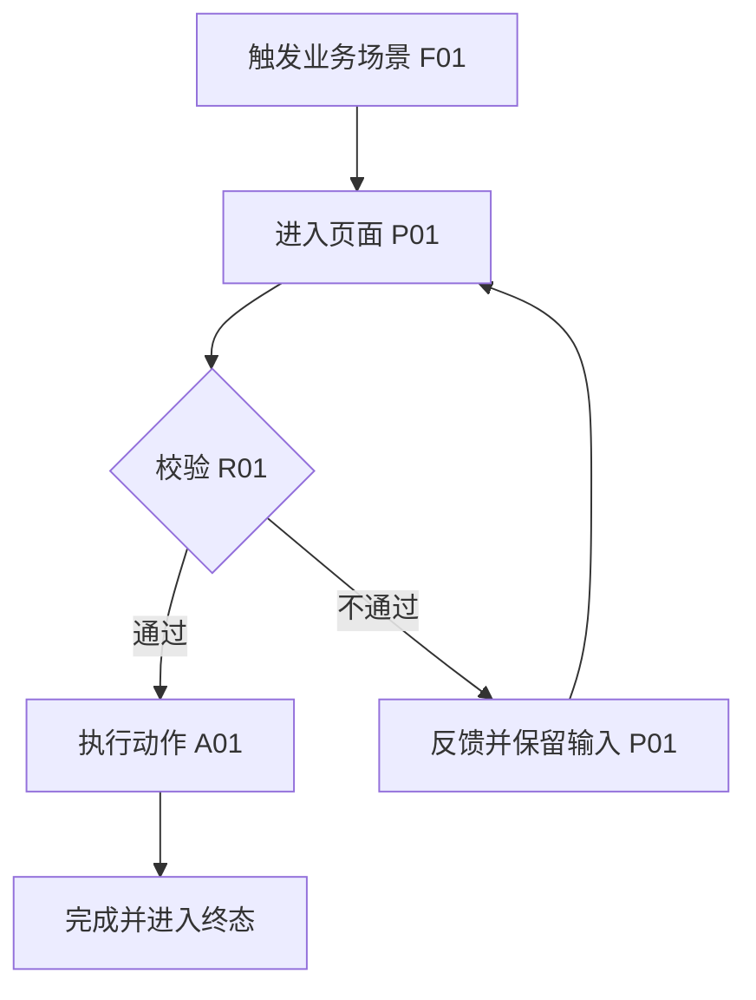

# [产品或功能] 产品需求文档（PRD）

> 模板版本：V1.1。方括号为填写提示，正式交付时替换为实际内容或明确待决事项。按项目复杂度保留适用章节；局部修订沿用原有结构、编号和基线，不因模板升级而强制重排。正文以业务需求为权威，原型交接仅引用，不重复定义。

**章节索引** [文档信息](#00-文档信息与约定) · [范围](#01-背景目标与范围) · [流程](#02-用户角色与业务流程) · [功能](#03-功能需求与业务规则) · [页面](#04-页面结构与布局) · [交互](#05-页面交互与状态) · [系统契约](#06-数据与系统契约) · [验收](#07-验收标准与测试场景) · [待决](#08-待决事项与风险存在时填写) · [原型交接](#09-原型交接原型交付时填写) · [上线成效](#10-上线成效按需)

## 00 文档信息与约定

### 0.1 版本、基线与变更

| 版本与状态 | 基线与可定位出处 | 本次交付范围与变更 | 确认依据 |
|---|---|---|---|
| [Vx.y／草案可评审／已确认可交接] | [文件、版本或指纹、来源章节] | [模块、变更及受影响编号] | [已确认决策或待确认事项] |

正式交接使用可区分的基线版本。同名同版本内容不同或缺少版本时，记录文件出处与 SHA-256。

### 0.2 原型交接摘要（原型交付时填写）

> 本表是交付索引，在正文完成后汇总；详细映射以第09章为准，不在此重复业务规则。

| 目标端与入口 | 本次原型范围 | 走查起点与前置 | 关键受阻项与索引 |
|---|---|---|---|
| [PC／移动端及入口，或系统事件观察入口] | [Pxx、Fxx、系统事件] | [角色、样例业务键、初始状态、主链和失败路径] | [Dxx，关联 Pxx／Axx／ACxx] |

### 0.3 编号与引用规范

同一项目在 PRD、原型指南、原型 HTML、SKILL.md 中使用一致编号；修订时沿用已确认编号，删除后留空，跨版本不重排、不复用。已有项目编号优先。新增编号查项目台账或历史基线，核对跨模块已分配编号和退役编号。历史缺失时，仅核实当前材料内唯一性，并标明跨版本未核实。

| 类型 | 新建项目默认格式 | 用途 |
|---|---|---|
| 页面 | `P` + 至少两位数字，如 `P01` | Page Map、页面规格、原型页面 |
| 功能 | `F` + 至少两位数字，如 `F01` | 功能、页面与验收映射 |
| 验收 | `AC` + 数字，如 `AC01` | 验收、原型走查与证据 |
| 规则（按需） | `R` + 至少两位数字，如 `R01` | 跨功能复用或需要独立追踪的业务规则 |
| 动作（按需） | `A` + 至少两位数字，如 `A01` | 跨表引用的关键交互动作；简单动作可用 `Pxx/区域/控件` 定位 |
| 待决事项 | `D` + 至少两位数字，如 `D01` | 待决问题及受阻路径 |

以上编号在项目内唯一且稳定；不要求每个控件、简单规则都分配独立编号。规则可引用既有规则编号或稳定章节锚点。

**依赖标注：** 无依赖 `—`；单依赖 `F03`；多依赖 `F05/F01`；跨模块 `F06(交易中心)`；外部依赖 `会员系统/接口名`。不得将尚未确认的外部依赖写为已具备。

### 0.4 章节适用性与最低交付契约

> 新写 PRD 先完成 §0.1 及第 01～03、07 章的适用内容，随后叠加下表中所有适用情形。补全或局部修订沿用原稿结构，只补受影响的条目及引用。按需项达到触发条件时填写。纯后台需求可省略页面章节。

| 触发条件 | 在基础内容上补充 |
|---|---|
| 有界面或交互 | 第 04、05 章，覆盖实际页面、动作与状态 |
| 多角色或对象有状态转换 | 第 02、03 章补角色协作、权限引用或状态转换 |
| 涉及核心数据、权限、接口或纯后台任务 | 第 06 章按场景补系统契约 |
| 有规则冲突、关键缺口或需要跟踪的风险 | 第 08 章，标出来源、待决及受阻范围 |
| 交付目标包含原型 | 第 09 章和 §0.2 摘要。存在模拟时填 §9.3 |

**原型最低契约：** 纳入范围的关键功能须有 `Fxx → Pxx → Axx（或稳定控件定位）→ ACxx`；纯系统事件采用 `Fxx／事件 → ACxx`。页面有入口/布局/状态，动作有前置/分支/反馈/副作用，模拟场景有固定数据与重置方式。缺失项登记 Dxx，禁止默认为已确认。

## 01 背景、目标与范围

### 1.1 背景与问题

[目标用户、现状流程、痛点、需求来源与可定位出处。]

### 1.2 目标与预期结果

[分别说明用户任务、业务成效和本期可交付目标；避免将页面数量等同于业务目标。]

### 1.3 本期范围与排除项

| 类别 | 内容 | 依据／备注 |
|---|---|---|
| 纳入 | [本期功能、角色、端] | [决策或来源] |
| 排除 | [明确不做的功能] | [原因／后续阶段] |
| 依赖 | [外部系统、前置能力] | [状态和责任方] |

### 1.4 来源与已确认决策

[引用会议纪要、SRS、业务文档、既有 PRD 章节或决策编号；区分已确认事实、建议默认值与待决事项。存在冲突时进入第08章。]

## 02 用户角色与业务流程

### 2.1 角色与职责

| 角色 | 主要任务 | 可执行操作 | 数据范围／权限引用 |
|---|---|---|---|
| [角色] | [任务] | [关键动作] | [规则 Rxx 或 6.2] |

### 2.2 场景与触发条件

[描述场景、触发事件、前置条件、完成标志；多角色协作注明交接责任。]

### 2.3 核心业务流程

> 新增或变更关键用户动线、关键业务流程或后台关键分支时，用标准 Mermaid `flowchart` 描述。关键分支必须有去向，节点标注 Pxx／Fxx／Rxx 或状态，异常复杂时另绘。下图为占位示例，交付时替换。



### 2.4 角色协作与终态（按需）

[角色间移交、拒绝、撤回、恢复与最终业务状态。]

## 03 功能需求与业务规则

### 3.1 功能总览

> 复杂功能通过本表索引到 §3.2，跨功能规则引用 §3.3。简单功能可直接在一行写齐触发、判断和可观察结果，并关联来源和 AC。

| 功能 ID | 功能名称与用户目标 | 优先级 | 触发／前置 | 判断与可观察结果 | 关联页面 | 依赖 | 来源 | AC |
|---|---|---|---|---|---|---|---|---|
| F01 | [完成什么业务任务] | [Must／Should／Could 或既有口径] | [角色、事件、状态] | [简单功能写判断和结果，复杂功能引用 §3.2] | P01 | — | [出处] | AC01 |

### 3.2 功能详细需求

> 复杂功能按 `Fxx` 独立小节；简单功能在总览写齐时可省略本节。不得重复形成两套冲突的定义。

#### F01 [功能名称]

| 项目 | 规格 |
|---|---|
| 用户目标 | [可观察的业务结果] |
| 触发与前置 | [角色、权限、事件、初始状态] |
| 处理逻辑 | [输入、判断、系统处理、输出] |
| 成功结果 | [业务终态、界面反馈、数据变化] |
| 异常与恢复 | [失败分支、是否保留输入、重试条件] |
| 关联 | [Pxx／Rxx／Axx／ACxx／接口] |
| 来源 | [定位出处] |

### 3.3 业务规则（复杂或跨功能时）

| 规则 ID | 适用功能 | 条件与判断 | 允许／拒绝及结果 | 异常与恢复 | 来源 | 验收 |
|---|---|---|---|---|---|---|
| R01 | F01 | [可判定条件] | [处理及可观察结果] | [失败或冲突处理] | [文件、章节或决策编号] | AC01 |

### 3.4 业务状态与转换（有状态机时）

| 对象 | 当前状态 | 事件／动作 | 前置规则 | 目标状态 | 失败后状态 | 关联 AC |
|---|---|---|---|---|---|---|
| [对象] | [草稿] | [提交] | R01 | [已提交] | [保持草稿] | AC01 |

### 3.5 关键异常与恢复（按需）

[仅补充功能表无法充分表达的并发、超时、重复提交、部分失败、撤销和补偿；与第06章技术契约交叉引用。]

## 04 页面结构与布局

> 本次范围涉及 UI 时填写。按页面集中描述，先 Page Map，再逐页定义线框、区域、控件；避免全部线框与全部控件分离排列。视觉 Token、颜色、字号和组件外观优先引用项目设计系统，不在 PRD 重复像素规范。独立路由页必须有 Pxx；附属弹窗/抽屉默认用 `Pxx/弹层名` 定位，只有需要独立导航、复用或跨页追踪时才分配独立 Pxx。

### 4.1 页面清单（Page Map）

| 页面 ID 与职责 | 承载形式 | 入口与直达条件 | 出口与返回 | 参数及状态恢复 | 关联功能 |
|---|---|---|---|---|---|
| P01 [页面职责] | [独立页／弹窗／抽屉] | [来源页、操作、路由、权限] | [目标页、关闭或返回] | [业务键、筛选、页码、条数] | F01 |

### 4.2 页面导航关系

[描述菜单层级、跨页路径、直达、刷新、返回和缺参处理；关键动线引用 §2.3 的 Mermaid，也可按页面拆图。]

### 4.3 P01 [页面名称]

#### 4.3.1 页面定位

[页面职责、适用角色、入口、业务上下文及关联 Fxx。]

#### 4.3.2 ASCII 线框（新增关键页面或布局变化时）

逐区标注名称、作用及控件归属。

```text
+--------------------------------------------------+
| 标题区：识别当前页面              [主要操作 A01] |
+--------------------------------------------------+
| 查询区：按条件筛选 [条件1] [条件2] [查询]      |
+--------------------------------------------------+
| 列表区：浏览记录并操作 | 字段1 | 状态 | 操作               |
|         ...                                      |
+--------------------------------------------------+
| 分页区：查看总量及切换页码、每页条数                    |
+--------------------------------------------------+
```

#### 4.3.3 区域与控件规格

| 页面／区域 | 控件与类型 | 布局层级／顺序 | 绑定字段／数据源 | 默认值／可见条件 | 可操作条件与校验 | 状态与反馈 | 动作／规则 |
|---|---|---|---|---|---|---|---|
| P01／操作区 | [提交按钮] | [线框中的主要操作] | [关联表单数据] | [角色可见] | [可提交条件] | [提交中禁用、错误提示] | A01／R01 |

#### 4.3.4 页面状态

[必须覆盖本页面实际出现的首次加载、加载中、空数据、失败、无权限、只读、提交中、成功等状态；页面展示写在本节，业务对象状态引用 §3.4，控件迁移引用 §5.4。未出现的状态不强制列出。]

> 其他页面按 `4.x Pxx` 重复上述结构。弹窗／抽屉关联宿主页和触发动作；独立页注明无效 ID、缺参和无权访问处理。列表规模影响实现时明确加载、搜索、排序与分页口径。

## 05 页面交互与状态

> 有交互时填写。动作与第04章控件对应；同名操作以 Axx 或 `Pxx/区域/控件` 唯一定位。已在第03章定义的业务规则直接引用，不重复定义。纳入原型的关键动作必须覆盖：事件与输入 → 权限/状态前置 → 校验及成功/拒绝/异常分支 → 页面反馈和业务终态 → 数据副作用 → 恢复与 AC。

### 5.1 关键动作矩阵

| 动作定位 | 角色、权限及前置 | 触发与参数 | 校验及分支 | 成功反馈／业务与页面终态 | 拒绝／失败／未知结果及恢复 | 数据副作用与幂等 | F／R／AC |
|---|---|---|---|---|---|---|---|
| A01（P01／操作区／提交） | [角色、状态] | [点击、业务键、表单值] | [R01、通过／拒绝／异常] | [提示、业务状态、页面状态、跳转] | [拒绝原因、保留输入、超时/未知结果处理、重试条件] | [新增/更新/无变化、重复提交处理] | F01／R01／AC01 |

### 5.2 跨页导航与参数传递（按需）

| 起点及动作 | 目标页／承载 | 必传参数 | 返回与恢复 | 缺参／无效／无权处理 |
|---|---|---|---|---|
| [起点页／导航动作] | [目标页／承载] | [业务 ID] | [筛选、页码、滚动或表单状态] | [明确反馈与去向] |

### 5.3 表单、列表及弹层行为（按需）

[表单默认值、必填/枚举/边界值、校验时机、重复提交、失败输入保留；列表查询、排序、分页与刷新；弹窗关闭、取消、未保存提醒及成功后宿主刷新。通用行为引用项目组件/交互规范；仅记录本功能的差异。异步事件明确加载、超时、取消、结果未知及是否允许自动重试；执行结果未知不得默认重复提交。]

### 5.4 页面与交互状态矩阵（按需）

| 页面／控件 | 状态类型 | 触发条件 | 展示与允许动作 | 恢复或退出条件 |
|---|---|---|---|---|
| P01／提交按钮 | 交互：提交中 | [提交后] | [禁用、加载反馈] | [成功／失败／未知结果响应] |

> 若业务状态控制 UI，增加映射：`对象状态 → 页面展示 → 可见/可操作动作 → 规则 Rxx`；不要把“已发布”等业务状态与“加载中”等页面状态混用。

## 06 数据与系统契约

> 只写实现与验收必须遵守的产品契约；详细表结构、事务实现、部署细节由 HLD／LLD／API 文档承接。纯后台需求可用本章及第03章替代页面章节。

### 6.1 核心数据对象

| 对象／业务标识 | 关键字段及语义 | 权威来源 | 生命周期／状态 | 关联功能 |
|---|---|---|---|---|
| [对象／ID] | [字段、必填、业务含义] | [系统或数据源] | [创建、更新、删除等] | F01 |

### 6.2 权限与数据范围

| 角色／主体 | 对象及操作 | 数据范围 | 允许条件 | 拒绝行为与审计 | 关联规则／AC |
|---|---|---|---|---|---|
| [角色] | [查看／修改] | [本人／部门／机构] | [条件] | [拒绝、无泄露] | [关联规则与拒绝验收编号] |

### 6.3 接口与外部依赖

| 关联功能 | 系统／接口 | 用途与数据方向 | 同步／异步 | 状态 | 失败／超时处理 | 责任与确认条件 |
|---|---|---|---|---|---|---|
| F01 | [接口] | [请求与响应摘要] | [同步] | [已有／新增／待评估] | [重试、幂等或人工恢复] | [责任方及证据] |

### 6.4 一致性、并发、恢复及审计（按需）

[说明业务可观察的幂等要求、状态一致性、重复请求、并发冲突、补偿、审计事件和数据保留；具体实现引用设计文档。撤权明确生效时机与入口一致性。异步结果未知时写明待确认状态、可重试条件及上限、重复回执与副作用。]

### 6.5 非功能需求（按需）

| 维度 | 指标与统计口径 | 环境／负载 | 验证方法 | 关联 AC |
|---|---|---|---|---|
| [性能／可用性／安全等] | [阈值、分位数、时间窗口] | [测试环境和规模] | [压测／审计等] | [ACxx] |

## 07 验收标准与测试场景

> 本期必交付功能均应关联 AC。每条 AC 唯一且可复现；区分原型浏览器、Mock、服务联调与真实环境，不把原型行为等同于真实接口验证。

### 7.1 验收矩阵

| AC 与关联 F／R／A／P | 场景及前置数据 | 动作／系统事件 | 预期与观察点 | 验证层及方式 |
|---|---|---|---|---|
| AC01（F01／R01／A01／P01） | [角色、固定样例、初始状态] | [操作／事件] | [反馈、终态、数据影响、适用调用次数] | [浏览器／Mock／联调；观察入口] |

### 7.2 核心流程、边界与反例（按需）

[覆盖主链、拒绝、异常、恢复；高影响规则至少补一个反例，必要时同时检查终态与副作用。]

写法示例（仅当撤权规则已有依据）：列表加载后撤销指定记录的详情权限。浏览器走查观察拒绝反馈且页面不展示详情。服务联调重发详情请求，核对服务端拒绝且响应无详情字段。两层分别关联验收与证据。

### 7.3 测试数据与环境（按需）

[环境、测试账号及权限、固定业务键、数据来源、可复现条件。采用 Mock 时引用 §9.3 的固定样例、响应及重置方式。]

### 7.4 验收证据约定

[本章记录预期；执行结果另存并绑定 PRD、原型及接口版本。变更后核对证据仍适用的范围，标记受影响的旧证据失效，列出回归 AC 并记录复测结果。]

## 08 待决事项与风险（存在时填写）

### 8.1 待决事项与阻断范围

> 每个待决项须明确处理策略：`允许生成已确认部分`／`仅生成带显式标识的只读示意`／`阻断相关动作或路径`。不得擅自补齐权限、状态、金额、审批或其他高影响规则；不影响范围继续交付。

| 待决 ID 与关联条目 | 出处、冲突或缺口 | 受阻环节及范围 | 可继续交付范围 | 决策责任与确认条件 |
|---|---|---|---|---|
| D01（F01／A01／AC01） | [缺少规则依据] | [仅阻断某分支] | [已确认主链可继续] | [责任人、证据及决策条件] |

### 8.2 风险与应对（按需）

| 风险 | 影响 | 应对与责任 | 跟踪状态 |
|---|---|---|---|
| [风险] | [影响功能或交付] | [措施、责任方] | [待处理／已缓解] |

> 不得擅自补齐高影响待决规则；已确认范围可独立生成与交付，未确认路径显式标注受阻。

## 09 原型交接（原型交付时填写）

> 只记录覆盖、实现方式和就绪依据；业务规则、页面与动作的权威定义分别在第03～05章，预期验收在第07章。

### 9.1 原型范围与走查起点

[目标端、页面入口或系统事件观察入口、测试角色、固定样例数据、初始状态、主链及适用失败路径。]

### 9.2 功能、动作与验收映射

| 功能／规则与 AC | 入口、动作或系统事件 | 预期与观察点 | 范围 | 实现方式 | 就绪及依据 |
|---|---|---|---|---|---|
| F01／R01／AC01 | P01／A01 | [引用第07章断言] | [纳入／范围外] | [可交互／模拟交互／只读示意／不适用；注明 Mock] | [可制作／受阻／不适用；引用 Dxx] |

### 9.3 Mock 场景（存在模拟时必填）

> Mock 可实现已确认的范围，也可用有明确出处且无冲突的草案路径制作标明草案状态的评审预览。高影响待决路径仅按第08章展示标记或阻断操作。实际系统事件的状态、副作用和验收按第03、06、07章及 §9.2 记录。样例 ID、字段与关联关系须固定且可复现；模拟与真实联调状态严格区分。

| Mock 场景名或 ID | 关联 F／动作定位或事件／AC | 固定样例数据与关联键 | 初始业务／页面状态 | 模拟事件及响应分支 | 预期终态与副作用 | 重置方式 |
|---|---|---|---|---|---|---|
| 提交成功 | F01／A01／AC01 | [固定业务键及字段值] | [草稿／可编辑] | [提交并返回成功响应] | [状态变为已提交，记录变化按 AC01 核对] | [恢复固定初始数据] |

仅在需要跨表引用时为 Mock 分配稳定编号。其他场景可用场景名或 AC 定位。

[补充 Mock 数据来源、模拟对象、触发方式、异步等待/超时、场景切换与重置入口。真实 API 未联通不得标记为真实联调通过。]

## 10 上线成效（按需）

| 指标 | 定义与口径 | 当前基线 | 目标 | 衡量周期 | 数据来源 |
|---|---|---|---|---|---|
| [业务目标关联指标] | [计算规则、对象、范围] | [已知值／待取数] | [已确认／待决] | [窗口] | [出处／取数计划] |

> 上线成效、功能验收与非功能阈值分别记录，不相互替代。

---

## 交付前核对（起草指导，正式交付可移除）

1. **来源与引用**：本次涉及的编号、页面、动作、规则和验收可定位。查历史与退役编号，历史资料缺失时标明未核实。局部修订对照原稿，检查旧值、直接引用及范围外内容。
2. **规则与验收**：本期承诺功能有触发、判断、可观察结果和验收。高影响规则补适用反例，必要时同时观察终态和副作用。
3. **页面、动作与模拟**：只核对适用路径。界面路径检查入口、反馈、返回与状态恢复；系统事件检查状态与副作用；采用 Mock 时检查固定输入、响应和重置。核对线框区域用途、Mermaid 分支与正文规则及 AC 一致。原型走查及联调结果由下游绑定实际版本。
4. **待决与受阻**：定位依据、待决编号和受阻路径。保留可交付范围，待确认规则由业务证据闭合。
